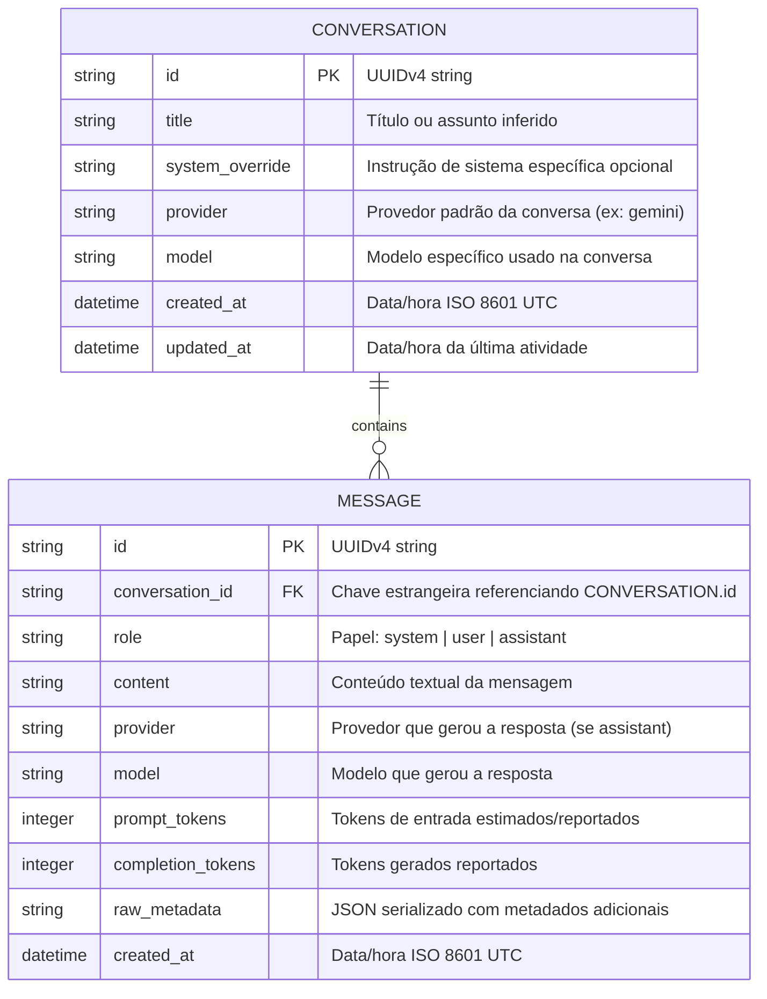

# Modelo de Banco de Dados — ULTRON

O modelo de dados do ULTRON foi projetado para alta escalabilidade e simplicidade, utilizando chaves primárias UUIDv4 em formato string (compatível universalmente com SQLite e nativo em PostgreSQL).

## Diagrama Entidade-Relacionamento (ERD)

## Índices e Otimizações
1. `conversations.id`: Chave primária com índice B-tree único.
2. `conversations.updated_at`: Índice decrescente para recuperação rápida de conversas recentes (`ORDER BY updated_at DESC`).
3. `messages.conversation_id`: Índice para acelerar a busca de mensagens por conversa (`WHERE conversation_id = ?`).
4. `messages.created_at`: Índice composto `(conversation_id, created_at ASC)` para ordenação cronológica do histórico com mínima sobrecarga de I/O.
