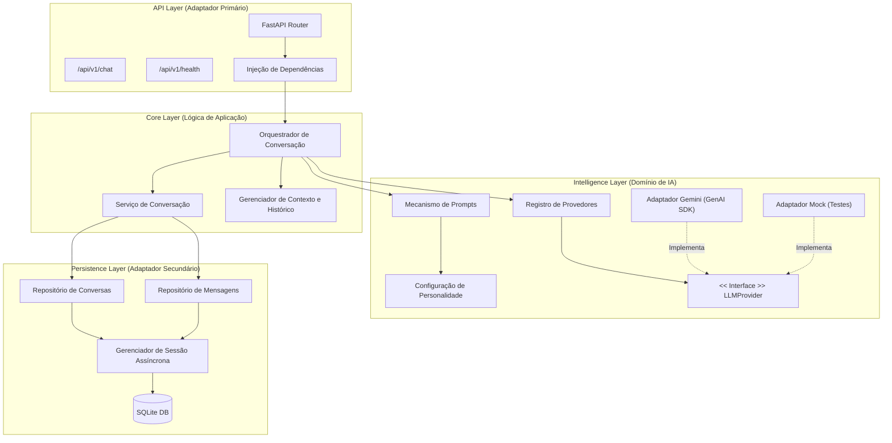

# Documento de Arquitetura de Software — ULTRON

**Versão:** 1.0.0  
**Status:** Aprovado para Implementação MVP  
**Data:** 2026-11-08  
**Autor:** Senior Software Architect / Equipe de Engenharia  

---

## 1. Visão Geral Executiva

O **ULTRON** é um assistente conversacional modular em Python projetado com foco em alta coesão, baixo acoplamento e extensibilidade. O sistema atua como uma plataforma intermediária entre interfaces de usuário/APIs e Provedores de Modelos de Linguagem Grande (LLMs), suportando inicialmente o Google Gemini (via Google Gen AI SDK) e preparado para integração transparente com OpenAI, Groq, Mistral, Ollama e outros.

### 1.1 Objetivos de Arquitetura
- **Desacoplamento de Provedores:** O núcleo da aplicação nunca referencia diretamente implementações de fornecedores externos.
- **Configurabilidade de Identidade e Personalidade:** O comportamento, tom, instruções de sistema e parâmetros de resposta do assistente são desacoplados do mecanismo de inferência.
- **Gerenciamento de Contexto Inteligente:** Política explícita de controle de histórico e limites de tokens, evitando estourar as janelas contextuais do modelo.
- **Persistência Assíncrona e Robusta:** Suporte a conversas e mensagens via SQLAlchemy 2.0 com SQLite no MVP e caminho claro para migração PostgreSQL.
- **Prontidão Operacional e DevSecOps:** Validação estrita de entradas, tratamento estruturado de erros e sanitização de logs contra vazamento de credenciais ou dados sensíveis.

---

## 2. Padrão Arquitetural

A arquitetura do ULTRON adota os princípios de **Clean Architecture** e **Arquitetura em Camadas (Layered Architecture)** com **Ports and Adapters (Arquitetura Hexagonal)** para integrações externas.

---

## 3. Descrição das Camadas

### 3.1 Camada de API (`app/api/`)
- **Responsabilidade:** Recebe requisições HTTP, valida payloads com modelos Pydantic, injeta serviços e devolve respostas padronizadas.
- **Regra Rígida:** Não contém lógica de negócios de LLM nem queries SQL diretas.

### 3.2 Camada Core (`app/core/`)
- **`orchestrator.py`:** Coordena o ciclo de vida da mensagem:
  1. Carrega ou valida a conversa ativa.
  2. Persiste a mensagem de entrada do usuário.
  3. Solicita ao `ContextManager` a montagem do histórico relevante.
  4. Aciona o `PromptEngine` para aplicar a identidade/personalidade.
  5. Despacha ao provedor LLM configurado.
  6. Normaliza e persiste a resposta do assistente.
  7. Retorna o resultado estruturado.
- **`chat_service.py`:** Operações de CRUD e consulta sobre sessões de conversa e histórico.
- **`context_manager.py`:** Algoritmo de filtragem e truncagem de histórico por limite de mensagens e aproximação de contagem de tokens.

### 3.3 Camada de Inteligência (`app/intelligence/`)
- **`providers/base.py`:** Define a interface abstrata assíncrona `LLMProvider` com métodos `generate_response()`, `health_check()` e propriedades de capacidade.
- **`providers/registry.py`:** Gerencia provedores instanciados em runtime via Factory Pattern.
- **`providers/gemini.py`:** Integração oficial com `google-genai` isolando detalhes específicos da Google API.
- **`personality/`:** Instruções declarativas de identidade (`system_prompt.txt` ou YAML).
- **`prompt_engine.py`:** Monta a estrutura final de system instruction + histórico formatado + mensagem do usuário.

### 3.4 Camada de Persistência (`app/database/`)
- Utiliza **SQLAlchemy 2.0 Assíncrono** (`aiosqlite`).
- Tabelas: `conversations` e `messages`.
- Padrão **Repository Pattern** isolando o ORM da camada de aplicação.

---

## 4. Requisitos Não Funcionais
1. **Performance:** Operações assíncronas I/O-bound (`async/await`) em todas as etapas de rede e banco de dados.
2. **Segurança:** Sanitização de entradas, proteção contra prompt injection básico, proibição de chaves em texto aberto nos logs.
3. **Testabilidade:** Mínimo de 85% de cobertura de código, com suite unitária totalmente independente de chamadas externas de rede através de mocks e o `MockProvider`.
4. **Portabilidade:** Empacotamento padrão Python com suporte a `uv`, `venv` e conteinerização via Docker.
