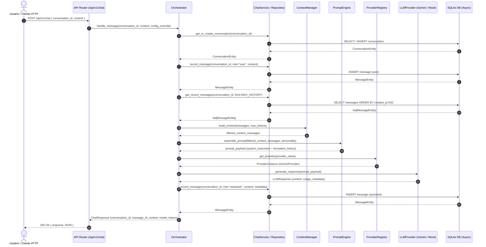

# Fluxo de Dados do Sistema — ULTRON

Este documento descreve a sequência de eventos durante uma solicitação conversacional típica enviada à API do ULTRON.

## 1. Diagrama de Sequência de Chat

## 2. Tratamento de Exceções e Resiliência no Fluxo

1. **Falha de Validação na Entrada:** Se o corpo da requisição tiver campos inválidos ou vazios, o FastAPI intercepta imediatamente no middleware Pydantic e devolve `422 Unprocessable Entity`.
2. **Falha de Conexão com o Provedor LLM:** Se a API externa do Gemini retornar erro de autenticação, cota excedida ou timeout, o `GeminiProvider` normaliza o erro em exceções de domínio (`ProviderAuthenticationError`, `ProviderRateLimitError`, `ProviderUnavailableError`). O `Orchestrator` ou middleware de exceção converte em HTTP 502/503/504 com payload padronizado, sem vazar tokens nem stack traces sensíveis.
3. **Falha no Banco de Dados:** Se a transação do banco falhar, a sessão assíncrona executa rollback explícito e a requisição retorna HTTP 500 com log estruturado de erro.
